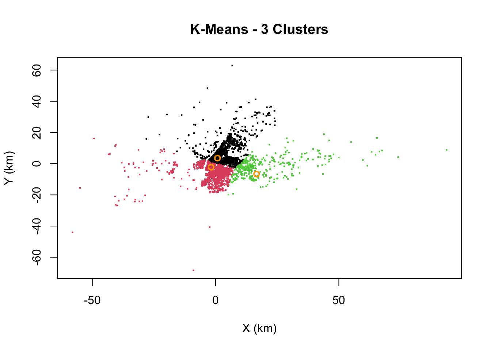
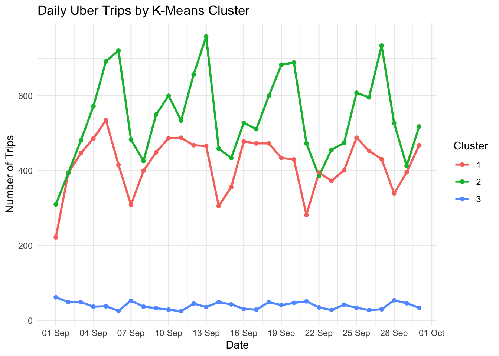
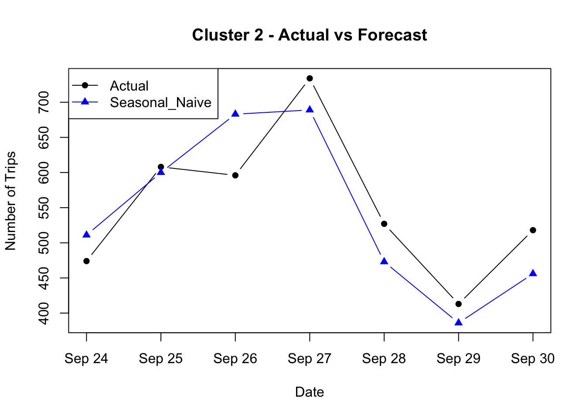

# Uber Pickup Clustering & Demand Forecasting

**Exploratory spatial clustering and time-series forecasting of Uber pickups in New York City, using R and Quarto.**

This project investigates whether Uber pickup locations form meaningful geographical clusters, how pickup activity varies across those areas, and how accurately different time-series models forecast daily pickup counts.

> **Important:** The forecasts refer to counts in a **30,000-trip random sample**, not to the full volume of Uber rides in NYC.

## Project overview

- **Data:** September 2014 Uber pickups in NYC (1,028,136 records in the original file).
- **Sample:** 30,000 pickups selected with `set.seed(42)`.
- **Spatial methods:** K-Means and CLARA, applied to latitude/longitude transformed to approximate local kilometres.
- **Cluster validation:** Hopkins statistic, Silhouette score, Calinski–Harabasz index, Gap statistic, and Adjusted Rand Index (ARI).
- **Temporal analysis:** Hourly and daily pickup patterns within each K-Means cluster.
- **Forecasting:** Naive, Seasonal Naive, ETS, and ARIMA, compared using Mean Absolute Error (MAE).
- **Tools:** R, Quarto, `factoextra`, `cluster`, `fpc`, `mclust`, `dplyr`, `ggplot2`, and `forecast`.

## Key results

**Three geographical clusters** were selected for the downstream analysis as a practical compromise between internal validation and interpretability. The Adjusted Rand Index between K-Means and CLARA was **0.837**, indicating strong agreement between their cluster assignments (not predictive accuracy).



The first two clusters show stronger weekly patterns in sampled pickup counts, while the third contains fewer observations and less pronounced weekly variation.



### Forecasting comparison

The first **23 days** (September 1–23, 2014) were used for training, and the final **7 days** (September 24–30) for testing. Lower MAE is better.

| Cluster | Naive | Seasonal Naive | ETS | ARIMA | Best on this holdout |
|:--|--:|--:|--:|--:|:--|
| 1 | 61.86 | **37.14** | 41.15 | 91.43 | Seasonal Naive |
| 2 | 109.14 | **45.71** | 52.04 | 85.95 | Seasonal Naive |
| 3 | 10.29 | 11.14 | **8.01** | **8.01** | ETS / ARIMA (tie at 2 decimals) |

Seasonal Naive performed best for Clusters 1 and 2, while ETS and ARIMA tied at the reported precision for Cluster 3. These results illustrate why simple baselines should be included when evaluating more complex models.



## Repository structure

```text
.
├── uber_clustering_forecasting.qmd   # Quarto source (R analysis)
├── reports/
│   └── uber_clustering_forecasting.html  # Self-contained rendered report
├── figures/                        # Selected plots for quick review
├── data/
│   └── README.md                   # Dataset source and preparation
├── .gitignore
└── README.md
```

## Reproduce the analysis

1. Install [R](https://www.r-project.org/) and [Quarto](https://quarto.org/docs/get-started/).
2. Install the required R packages:

   ```r
   install.packages(c(
     "factoextra", "cluster", "fpc", "mclust",
     "dplyr", "ggplot2", "forecast"
   ))
   ```

3. Download the **September 2014 Uber pickups CSV** from [FiveThirtyEight's public Uber trip dataset](https://github.com/fivethirtyeight/uber-tlc-foil-response/tree/master/uber-trip-data). Rename `uber-raw-data-sep14.csv` to `uber-data.csv` and place it in the `data/` folder. See [data/README.md](data/README.md).
4. From the repository root, run:

   ```bash
   quarto render uber_clustering_forecasting.qmd --to html
   ```

   The rendered report is also included in [`reports/uber_clustering_forecasting.html`](reports/uber_clustering_forecasting.html) for offline viewing; download it and open it in a browser.

## Limitations

- **Sample, not population:** The daily series describes a random subsample of rides. Forecasts should not be interpreted as full NYC Uber demand.
- **Small temporal sample:** 23 training days and one seven-day test window are insufficient for strong generalization claims. Rolling-origin backtesting over more months would be preferable.
- **Spatial information from the test period:** Clustering was performed on all sampled September pickups before the temporal split. A truly prospective pipeline should fit the spatial segmentation using historical data only.
- **Model selection on the holdout:** The reported best models were chosen using the same test period used to report MAE. An independent final test period would be needed for an unbiased performance estimate.
- **Exploratory scope:** No production pipeline, live prediction API, or deployment is included.

## Data attribution

Original Uber pickup records: [FiveThirtyEight — Uber TLC FOIL Response](https://github.com/fivethirtyeight/uber-tlc-foil-response). The raw CSV is **not committed** to this repository; obtain it from the original source.

## Author

[Artem Ratushnyi](https://github.com/RatushnyiArtem)
# uber-demand-clustering-forecasting
